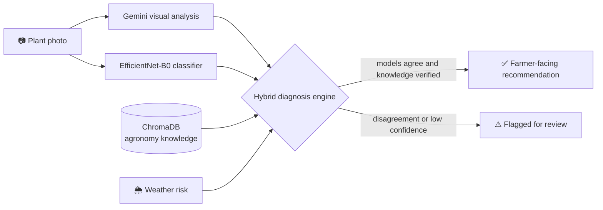

<div align="center">

# 🌾 Crop Guardian

### *Understand Your Crops. Protect Your Harvest.*

**An AI-powered crop disease assistant that turns a plant photo into a careful, explainable diagnosis, built for farmers in Bangladesh.**

<br>


</div>

---

## ✨ What is Crop Guardian?

Crop Guardian lets a farmer snap a photo of a sick leaf and get back a structured assessment: what the problem likely is, how confident the system is, what the agricultural literature says, and when the weather makes things worse.

It does **not** blindly trust a single model. Two independent AIs look at every supported photo, a knowledge base checks their claims, and the system **holds back advice when it isn't sure**. Safety over swagger.

## 🚀 Features

| | Feature | Details |
|---|---|---|
| 🔬 | **Hybrid AI diagnosis** | Google Gemini vision and a custom EfficientNet-B0 classifier, compared side by side |
| ⚖️ | **Disagreement detection** | Conflicting predictions are flagged for human review instead of hidden |
| 📚 | **RAG knowledge grounding** | ChromaDB and Sentence Transformers retrieve verified agronomy knowledge |
| 🌦️ | **Weather risk intelligence** | Daily and hourly weather analysis, disease-risk scoring and alerts for Bangladesh |
| 📖 | **Disease Guide** | Browsable library of crop diseases and their management |
| 🕘 | **Diagnosis History** | Every diagnosis saved together with the original image |
| 🖨️ | **Printable PDF reports** | One-click shareable diagnosis reports |
| 🌐 | **Bilingual UI** | English and বাংলা |

## 🌱 Supported Crops

<div align="center">

| 🥔 Potato | 🍅 Tomato | 🌾 Rice | 🍆 Brinjal | 🌿 Jute |
|:---:|:---:|:---:|:---:|:---:|
| Gemini + EfficientNet | Gemini + EfficientNet | Gemini | Gemini | Gemini |

</div>

> **Note:** The EfficientNet-B0 classifier currently covers **potato and tomato** (13 classes). Other crops use the Gemini assessment pathway.

## 🧠 How It Works



1. **Two opinions.** Gemini and EfficientNet-B0 independently assess the image.
2. **Cross-check.** The hybrid engine compares them and measures uncertainty.
3. **Ground truth.** The RAG system retrieves matching knowledge from the disease knowledge base.
4. **Guardrails.** Recommendations are **restricted** whenever model agreement or knowledge verification isn't satisfied.

## 📊 Classifier Performance

| Metric | Result |
|---|---|
| Architecture | EfficientNet-B0 (224×224 input) |
| Classes | 13 (potato and tomato) |
| Validation accuracy | 99.71% |
| Test accuracy | 99.53% |
| Top-3 accuracy | 100% |

The confusion matrix is in [`eval/confusion_matrix.png`](eval/confusion_matrix.png).

## 🛠️ Tech Stack

**Frontend:** React · TypeScript · Vite · Tailwind CSS

**Backend:** Python 3.11 · FastAPI · Uvicorn · Pydantic

**AI / ML:** Google Gemini API · PyTorch · Torchvision · TIMM · EfficientNet-B0

**RAG:** ChromaDB · Sentence Transformers · `all-MiniLM-L6-v2`

## 🗂️ Project Structure

```
crop-guardian/
├── api_server.py              # FastAPI application
├── crop_guardian_engine.py    # Main diagnosis pipeline
├── hybrid_diagnosis.py        # Gemini + EfficientNet comparison
├── hybrid_rag.py / rag.py     # Retrieval-augmented knowledge layer
├── classifier.py              # EfficientNet-B0 inference
├── weather_*.py               # Weather ingestion, risk and alerts
├── crop_guardian_reports.py   # History and PDF reports
├── knowledge/                 # Disease knowledge base
├── models/                    # Trained classifier and metadata
├── eval/                      # Evaluation results and metrics
└── frontend_preview/          # React + TypeScript web app
```

## ⚡ Quick Start

**Requirements:** Python 3.11 · Node.js and npm · a [Gemini API key](https://aistudio.google.com/apikey)

### 1. Backend

```bash
git clone https://github.com/Hasibur-sun/crop-guardian.git
cd crop-guardian

python -m venv .venv
source .venv/bin/activate        # Windows: .venv\Scripts\activate
pip install -r requirements.txt
```

Create a `.env` file:

```env
GEMINI_API_KEY=your_gemini_api_key
# Optional: tester login protection
TESTER_ACCESS_CODE=
TESTER_TOKEN_SECRET=
```

Start the API:

```bash
python api_server.py
```

### 2. Frontend

```bash
cd frontend_preview/crop-guardian
npm install
npm run dev
```

Point the app at your backend with `VITE_API_BASE_URL`. With no API address set, the app runs in **demo mode**. See [`BACKEND_INTEGRATION.md`](frontend_preview/crop-guardian/docs/BACKEND_INTEGRATION.md) for details.

## 🔌 API Overview

| Method | Endpoint | Purpose |
|---|---|---|
| `POST` | `/api/diagnose` | Upload a photo and get a diagnosis |
| `GET` | `/api/weather` | Weather and disease-risk context |
| `GET` | `/api/history` | List past diagnoses |
| `GET` | `/api/history/{id}/pdf` | Download a printable report |
| `GET` | `/api/diseases` | Browse the Disease Guide |
| `GET` | `/api/health` | Health check |

## ⚠️ Disclaimer

Crop Guardian is a decision-support tool, not a replacement for an agronomist. Always confirm serious or uncertain diagnoses with a local agricultural extension officer before applying treatments.

---

<div align="center">

**Built with 💚 for farmers, by [Hasibur](https://github.com/Hasibur-sun)**

*If this project helps you, consider giving it a ⭐*

</div>
